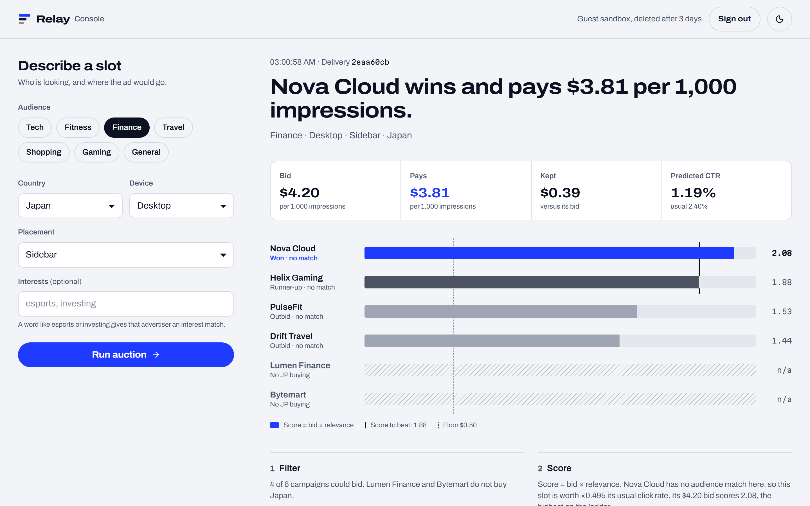

# Relay

**An ad server you can watch think.** Describe an ad slot and who is looking at it. Relay runs a
second-price auction on the server between six fictional advertisers, then shows every bidder's score,
who won, what they paid and how the price was worked out.

**Live:** https://relay-auction.pages.dev. Click **Run your own auctions** for a private guest
sandbox (no sign-up), or sign in with the shared demo account `demo@relay.dev` / `demo1234`.



## What's real and what's made up

| Real | Made up |
| --- | --- |
| The auction: it runs in a Cloudflare Worker on every request, and it's deterministic (the same request always gets the same result) | The six advertisers, their bids, headlines and usual click rates |
| Accounts, with PBKDF2-SHA256 password hashing and HS256 session tokens | The traffic: every request is one somebody typed in. No ad is shown and no money moves |
| Delivery history, stored in Cloudflare D1 | The device and placement factors behind relevance (fixed estimates, not learned) |
| Timings: server time is measured by the Worker, round trip by your browser | |

## How an auction is decided

1. **Filter.** Campaigns that don't buy the request's country sit out.
2. **Score.** Each bid is weighted by relevance, the predicted click-through rate divided by the
   campaign's usual one. The prediction comes from audience match (segment, interest keyword or none),
   device and placement. `score = bid × relevance`.
3. **Rank.** The highest score wins. A score under the $0.50 floor can't win.
4. **Price.** The winner pays the lowest bid that would still have beaten the runner-up's score (or the
   floor, if there is no runner-up), plus $0.01, and never more than its own bid. This is a
   generalised second-price auction.

The engine is [`api/auction.ts`](api/auction.ts). Its tests check the pricing rules against every
possible request.

## Run it locally

Needs Node.js 22.18 or newer.

```bash
npm run setup   # install, create .dev.vars, apply the D1 migration locally
npm run dev     # app on http://localhost:5173, API on :8788
```

```bash
npm run check   # lint, tests, type-check and production build
```

## Architecture

```
Browser ── React 19 + TypeScript + Vite (src/)
   │  same-origin /api/* calls, Bearer token
   ▼
Cloudflare Pages
   ├─ static app (dist/)
   └─ Pages Function  functions/api/[[route]].ts ─► api/router.ts
                                                     ├─ api/auction.ts   the auction, pure
                                                     ├─ api/crypto.ts    PBKDF2 + JWT on Web Crypto
                                                     └─ api/db.ts        queries
                                                            ▼
                                                     Cloudflare D1 (SQLite)
                                                     users · campaigns · deliveries
```

- `shared/contract.ts` holds the request and response types both sides use.
- `migrations/` creates the schema and seeds the advertisers and the demo account.
- Guest sandboxes are deleted after 72 hours. History on the shared demo account is kept for 7 days.
- Worker clocks only advance during I/O, so "server time" mostly measures the D1 reads. The auction
  itself takes well under a millisecond.

### API

| Route | Auth | Does |
| --- | --- | --- |
| `GET /api/auction/preview?placement&device&country` | no | Runs one auction per audience segment without recording anything (powers the landing page) |
| `GET /api/campaigns` | no | The advertiser catalog |
| `POST /api/auth/guest` | no | Creates a private guest sandbox |
| `POST /api/auth/signup`, `POST /api/auth/login` | no | Email and password accounts |
| `GET /api/me` | yes | The signed-in account |
| `POST /api/deliveries` | yes | Runs an auction for an ad request and records it |
| `GET /api/deliveries`, `GET /api/deliveries/:id` | yes | History and totals |

## Deploy

Everything runs on Cloudflare's free tier: Pages for the app and functions, and D1 for the data.

```bash
npx wrangler d1 migrations apply relay --remote   # once, and after adding a migration
npx wrangler pages secret put JWT_SECRET --project-name relay-auction
npm run deploy                                     # check, then deploy dist/ and functions/
```

## License

MIT. See [LICENSE](LICENSE).
